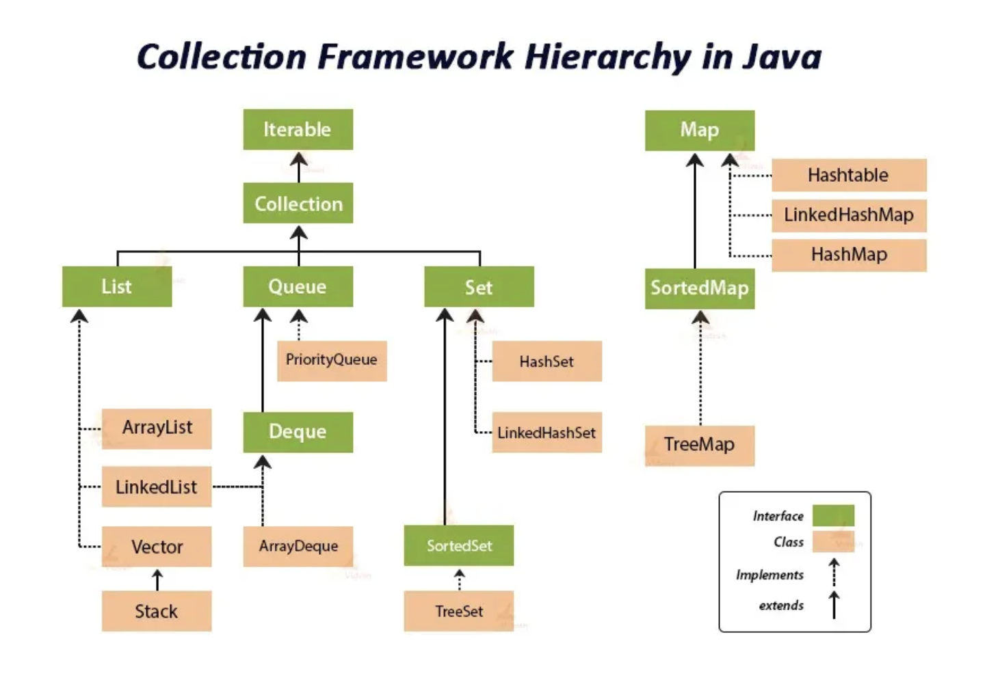

# Collection Frameworks
### Why need collections
| Feature         | Array                                                  | Collection                                                        |
| --------------- | ------------------------------------------------------ | ----------------------------------------------------------------- |
| Size            | Fixed (cannot change after creation)                   | Dynamic (can grow/shrink)                                         |
| Resizing        | Not supported (new array needed)                       | Automatically handled                                             |
| Utility methods | Limited (`Arrays` class: sort, search, copy, toString) | Rich built-in methods (`add`, `remove`, `contains`, `sort`, etc.) |
| Flexibility     | Low                                                    | High                                                              |


### Collection Framework Hierarchy
```
Collection
 ├── List
 ├── Set
 └── Queue
Map (separate)
```
**Collection** = group of individual elements.

**Map** = key–value pairs (not part of Collection).


| Interface  | Link                                                                                                                                       |
| ---------- | ------------------------------------------------------------------------------------------------------------------------------------------ |
| Collection | [https://docs.oracle.com/javase/8/docs/api/java/util/Collection.html](https://docs.oracle.com/javase/8/docs/api/java/util/Collection.html) |
| List       | [https://docs.oracle.com/javase/8/docs/api/java/util/List.html](https://docs.oracle.com/javase/8/docs/api/java/util/List.html)             |
| Set        | [https://docs.oracle.com/javase/8/docs/api/java/util/Set.html](https://docs.oracle.com/javase/8/docs/api/java/util/Set.html)               |
| Map        | [https://docs.oracle.com/javase/8/docs/api/java/util/Map.html](https://docs.oracle.com/javase/8/docs/api/java/util/Map.html)               |


## Collection Interface
The Collection is the root interface of the Java Collections Framework.

### methods: 
add(), remove(), contains(), size(), isEmpty().
```java
Collection<String> c = new ArrayList<>();
c.add("Hello");
```

```java
package java.util;

public interface Collection<E> extends Iterable<E> {

    // Basic operations
    int size();
    boolean isEmpty();
    boolean contains(Object o);
    boolean add(E e);
    boolean remove(Object o);
    void clear();

/* ---------------- Bulk Operations ---------------- */

    boolean containsAll(Collection<?> c);          // Checks if all elements of c exist in this collection
    boolean addAll(Collection<? extends E> c);     // Adds all elements from another collection
    boolean removeAll(Collection<?> c);            // Removes all elements found in c
    boolean retainAll(Collection<?> c);            // Keeps only elements also found in c


    // Iterator
    Iterator<E> iterator();

}
```
```java
package java.lang;

public interface Iterable<T> {
    Iterator<T> iterator();  // Returns an Iterator
}
```
### Iterator
A cursor-like object that lets you traverse elements one by one in a collection.
- “Iterator gives a universal way to loop through any Collection”
#### Examples
###### Basic Iteration of Collection
```java
import java.util.*;

public class CollectionStringIterator1 {
    public static void main(String[] args) {
        // Collection interface reference
        Collection<String> fruits = new ArrayList<>();
        fruits.add("Apple");
        fruits.add("Banana");
        fruits.add("Cherry");

        Iterator<String> it = fruits.iterator();

        while (it.hasNext()) {
            String fruit = it.next();
            System.out.println(fruit);
        }
    }
}

```
###### Remove Certain element While Iterating
```java
Collection<String> names = new ArrayList<>();
names.add("Alice");
names.add("Bob");
names.add("Charlie");
names.add("David");

Iterator<String> it = names.iterator();

while (it.hasNext()) {
    String name = it.next();
    if (name.startsWith("A") || name.startsWith("D")) {
        it.remove(); // safe removal
    }
}

System.out.println(names);
}
```
### List Interface (Ordered, Duplicates Allowed)

```java
List<E> extends Collection<E>
```
- Adds ordered and index-based behavior

- Duplicates and null allowed

- Supports positional access (get/set by index)

#### New Methods in List
Method	Description
```java 
get(int index)	// Returns element at a specific position
set(int index, E element)	// Replaces element at position
add(int index, E element)	// Inserts element at a specific position 
remove(int index)	// Removes element at a specific position
indexOf(Object o)	// Returns first occurrence index
lastIndexOf(Object o)	// Returns last occurrence index
subList(int from, int to)	// Returns a portion of the list
```
| Method                | Action                   | Effect on Size      | Example                                |
| --------------------- | ------------------------ | ------------------- | -------------------------------------- |
| `set(index, element)` | Replace element at index | Size stays the same | `[A, B, C] → set(1, X) → [A, X, C]`    |
| `add(index, element)` | Insert element at index  | Size increases by 1 | `[A, B, C] → add(1, X) → [A, X, B, C]` |

Examples:
```java
import java.util.*;

public class ListExample {
    public static void main(String[] args) {
        List<String> fruits = new ArrayList<>();
        fruits.add("Apple");
        fruits.add("Banana");
        fruits.add("Cherry");

        System.out.println(fruits.get(1)); // Banana
        fruits.add(1, "Mango");            // Insert at index 1
        System.out.println(fruits);        // [Apple, Mango, Banana, Cherry]

        fruits.remove(2);                  // Remove index 2
        System.out.println(fruits);        // [Apple, Mango, Cherry]

    }
}
```
#### ListIterator

ListIterator is a special type of iterator that works only with lists (ArrayList, LinkedList, etc.), allowing:

| Capability                      | Regular Iterator | ListIterator |
| ------------------------------- | ---------------- | ------------ |
| Move forward                    | ✅                | ✅            |
| Move backward                   | ❌                | ✅            |
| Get current index               | ❌                | ✅            |
| Add new element while iterating | ❌                | ✅            |
| Replace element                 | ❌                | ✅            |
#### Common Methods of ListIterator
| Method                  | Description                                                    |
| ----------------------- | -------------------------------------------------------------- |
| `boolean hasNext()`     | Checks if there’s another element ahead                        |
| `E next()`              | Moves forward and returns the next element                     |
| `boolean hasPrevious()` | Checks if there’s another element behind                       |
| `E previous()`          | Moves backward and returns the previous element                |
| `int nextIndex()`       | Returns the index of the next element                          |
| `int previousIndex()`   | Returns the index of the previous element                      |
| `void add(E e)`         | Adds an element at the iterator’s current position             |
| `void set(E e)`         | Replaces the last element returned by `next()` or `previous()` |
| `void remove()`         | Removes the last element returned by `next()` or `previous()`  |

* example
```java
import java.util.*;

public class ListIteratorDemo {
    public static void main(String[] args) {
        List<String> names = new ArrayList<>();
        names.add("Alice");
        names.add("Bob");
        names.add("Charlie");

        ListIterator<String> lit = names.listIterator();

        // Forward direction
        System.out.println("Forward:");
        while (lit.hasNext()) {
            System.out.println(lit.next());
        }

        // Backward direction
        System.out.println("\nBackward:");
        while (lit.hasPrevious()) {
            System.out.println(lit.previous());
        }
    }
}
```
